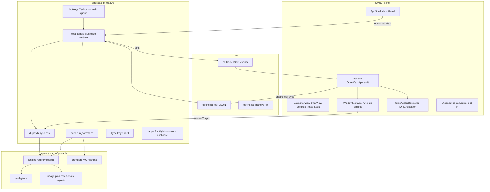

# OpenCast audit — Phase 0

Read-only recon of commit `c62faad` (2026-11-17, "Click Text OCRs a smaller frame, and the retry waits its turn"). No code was changed. Phase 1 has not started.

The knowledge graph in `graphify-out/` was built from `dd9ce6aa` and is stale. Findings below were checked against the current sources.

## What this app actually is

OpenCast 0.2.18 is a menu-bar macOS app. The UI is SwiftUI/AppKit (`macos/`, about 40k lines of Rust + Swift together). The engine is the portable crate `opencast-core`. `opencast-ffi` is a macOS static library with a C ABI (`opencast_start`, `opencast_call`, `opencast_free`, `opencast_hotkeys_fix`) plus one function-pointer callback into Swift. Linux builds of the FFI crate are an empty stub so `cargo test` still configures.

There is no `tauri.conf.json`, no React tree, no `package.json` for the app, and no `#[tauri::command]`. A 2026-10-13 plan ("Move the macOS glue off Tauri") already landed. `global-hotkey` still parses the old shortcut strings (`hotkeys.rs` test `parser_accepts_the_tauri_shortcut_strings`).

The brief's Phase 1–4 steps that name Tauri commands, `telemetry.ts`, React Profiler, Vitest, and a React error boundary need a Swift remap. That remap is under [Needs decision](#needs-decision). The budgets and the local-only telemetry goal still apply.

Installed binary (this machine, 2026-11-17): `~/Applications/OpenCast.app`, 18 MB, one executable. OpenCast was not running during this pass, so live RSS and idle CPU were not sampled. `~/Library/Logs/` has no OpenCast directory.

## Architecture

### Process lifetime

1. `AppShell` takes a flock on `~/.config/opencast/.instance.lock` (a second copy quits).
2. `applicationDidFinishLaunching` installs the status item and clipboard history, then `Task.detached` calls `opencast_start`.
3. `host::install` loads config, a cached app index, the tokio runtime, the hotkey listener, signal handlers (Caps Lock restore), and optional hyper-key remap. A background thread refreshes apps, Shortcuts, bookmarks, history, recents, and currency rates, then reloads if anything changed.
4. Swift applies presentation and theme, marks `ready`, shows the existing `IslandPanel`, and runs an immediate search.
5. `applicationWillTerminate` releases the power assertion, flushes clipboard history, and calls `op: shutdown` (Caps Lock only).

### Panel

`IslandPanel` (`macos/AppShell.swift`) is one borderless `NSPanel`, level 25, `canJoinAllSpaces` + `fullScreenAuxiliary`, created once and shown with `orderOut` / `makeKeyAndOrderFront`. It is not recreated per hotkey. It is not a non-activating panel: `show()` calls `NSApp.activate` and, on the first show of a session, animates down from the top of the screen for 160 ms (`OpenCastApp.show`). Later shows snap the frame, then still activate the app. Hide calls `NSApp.hide` when no other OpenCast window is up.

`LauncherView` switches on `Model.Mode`: search/list, actions, args, output, chat. The result list draws 8 rows (`listStart` window), not the full hit list.

### State

`Model` in `OpenCastApp.swift` is the panel store (query, rows, mode, icons, toasts). Settings use `SettingsState`. Rust `Engine` is an `Arc` behind a `Mutex` that is taken only long enough to clone the `Arc` (`with_engine`), so searches do not queue on that lock. Sidecars (usage, pins, notes, chats) sit behind an `RwLock` and are cloned out at the start of `Engine::search`.

### Plugin / script surface (do not break)

- Script commands: executables under the scripts dir with `@opencast.*` or `@raycast.*` headers. `@opencast.mode list` is the Script Filter. Timeout comes from `general.script_timeout_secs`. Runner: `scripts::run_with` (`tokio::time::timeout`, process killed).
- Extensions: git-installed trees with `.opencast-extension.json` (`extensions.rs`). macOS install/import shells out to `plutil` and `ditto`.
- Alfred workflows are imported into generated shell commands (`alfred.rs`).
- Config is `~/.config/opencast/config.toml` (or `OPENCAST_CONFIG_DIR`). Unknown keys become warnings, not silent drops.

The JSON `op` strings are an internal ABI between this Swift tree and this FFI crate, not a published plugin API. Changing an `op` still breaks the panel.

### Global hotkeys

`global-hotkey` / Carbon. `RegisterEventHotKey` only works for a manager created on the main queue. `hotkeys::on_main` runs inline on the main thread, otherwise `dispatch_async` plus a 10 s channel timeout so a stuck main thread cannot wedge startup. The old manager is dropped before the new one is built (`eventHandlerAlreadyInstalledErr`). Duplicate bindings inside OpenCast are reported. `Model.checkHotkeys` re-registers at 1 s and 4 s after launch, stores problems on `SettingsState.hotkeyProblems`, and flashes the first line. There is no sleep/wake or fast-user-switch re-register. `OPENCAST_HOTKEY_SYNC` restores the old blocking `dispatch_sync` path.

Presses are read on a dedicated thread. The toggle emits `show`/`hide`. Other bindings `runtime().spawn` `run_command` so the engine lock is not held across `.await`.

### Window management

Real path is `WindowManager` (`@MainActor`): AXUIElement for frames, `Spaces` (SkyLight) for desktop moves. Geometry is computed in Rust via `op: windowTarget` (`opencast-core/src/window.rs`: gaps, cycle sizes, displays, custom commands, notch/menu-bar work area). `crates/opencast-ffi/src/window_mgmt.rs` is `allow(dead_code)` and is not the snap path.

`MenuSearch` sets `AXUIElementSetMessagingTimeout(app, 1.0)`. `WindowManager` does not. Snap, layout capture, and selected-text reads run on the main actor with no timeout. Each snap `NSLog`s its duration.

Saved layouts live in `layouts.json`, keyed by name and a display signature of rounded `x,y,w,h` (`layouts::display_signature`). Restore uses `get_for`: exact signature, else the newest variant. `WindowManager.clamp` recenters a frame whose center hits no current screen. `applyLayout` matches windows by title, then by order, and swallows per-window `setFrame` errors (`try?`).

### Keep awake

`StayAwakeController` (`macos/StayAwake.swift`) takes `kIOPMAssertionTypePreventUserIdleSystemSleep` (what `caffeinate -i` uses). No `caffeinate` child. Modes: off, indefinite, 30m, 1h, 3h. Timed assertions use `kIOPMAssertionTimeoutActionRelease` plus a `Timer` on the calling run loop (menu actions hop to main). Quit calls `shutdown()` from `applicationWillTerminate`.

IOKit drops assertions when the creating process exits, including crash and `SIGKILL`. A Rust panic hook is still worth adding so logs flush, and so a future panic-without-exit cannot be the only cleanup. The signal handler in `host.rs` restores Caps Lock and `exit`s; it does not call Swift. Process exit is what releases the assertion on that path.

There is no sleep/wake re-acquire, no "until this app quits", and no assertion id in the UI. A failed `IOPMAssertionCreate*` sets mode back to off with no log.

### Persistence

Directory: `~/.config/opencast/` (override `OPENCAST_CONFIG_DIR`).

| File | Writer | Atomic rename | Version / recovery |
|---|---|---|---|
| `config.toml` | `config.rs` `std::fs::write` in place | no | serde defaults; unknown keys warned; file over 5 MB refused; parse failure is an error, not a reset |
| `layouts.json` | `layouts::write` in place | no | legacy one-layout-per-slug format accepted; corrupt JSON loads as empty |
| `chats.json` | temp file + rename | yes | corrupt loads as empty; save errors ignored |
| `usage.json` | temp file + rename | yes | `version` field, v1 counts migrated to v2 |
| `notes.json`, `pinned.json` | sidecar load/save | mixed | corrupt tends to default |
| `apps.json`, `shortcuts.json`, `bookmarks.json`, `history.json`, `recents.json`, `rates.json`, `mcp-tools.json`, `mcp-extras.json` | caches | generally in-place | rebuilt in the background |
| `profile.md` | append | no | |
| `.instance.lock` | flock | n/a | held until exit |

`config.toml` writes do refuse a rewrite that grows far past the edit (`set_general_key`). That is a safety check, not an atomic replace. A crash mid-`write` can truncate the file.

### Telemetry today

- `Diagnostics` (`macos/SeekView.swift`): `os.Logger` subsystem `dev.opencast.launcher`, category `diag`. Off unless UserDefaults `diagnostics` is set. Used by Seek OCR and screencapture. Comment in that file: NSLog lines never reach the unified log on macOS 27.
- Search (`OpenCastApp.deliverSearch`) and window snaps (`WindowManager.apply`) time themselves and `NSLog` only when search exceeds 25 ms, or always for snaps. Those lines are the wrong sink on current macOS, and the search line includes the full query.
- Rust warnings and hotkey failures go to `eprintln!`. No `tracing` subscriber. No log directory. No debug panel. No panic hook.

## IPC

### C ABI

| Symbol | Direction | File |
|---|---|---|
| `opencast_start(cb)` | Swift → Rust, once | `crates/opencast-ffi/src/lib.rs:42` |
| `opencast_call(json) -> *mut c_char` | Swift → Rust, sync | `lib.rs:48`, body `host::call_raw` |
| `opencast_free` | Swift frees the returned C string | `lib.rs:54` |
| `opencast_hotkeys_fix` | Swift → Rust, re-register | `host.rs:69` |
| `Callback(*const c_char)` | Rust → Swift | `host::emit` → `opencastCallback` → `Model.accept` |

`Engine.call` (`macos/Bridge.swift`) is synchronous. `try!` on `JSONSerialization` and a force-unwrapped UTF-8 string. A non-plist body crashes the panel. The returned JSON is parsed with `try?`; failure becomes `["error": raw]`.

`handle` wraps the op in `catch_unwind` and turns a panic into `{"error":"internal error"}`. The panic payload is dropped. A poisoned `Mutex`/`RwLock` stays poisoned, so later `.unwrap()` on that lock panics again and every later call on that path returns the same generic error.

### Request ops (`host::handle`, then `dispatch` for the rest)

Handled in `host.rs` before the fallback:

`hidden`, `shown`, `execute`, `pin`, `layoutSave`, `shutdown`, `configDir`, `copy`, `paste`, `pasteFront`, `seekClick`, `seekClose`, `reload`, `approveTool`, `chatSave`, `chatDelete`, `noteDelete`, `profileAppend`, `setHotkey`, `notesList`, `noteUpdate`, `expandSnippet`, `configGet`, `snippetAdd`, `snippetRemove`, `configSet`, `providerAdd`, `providerRemove`, `updateCheck`, `fetchPage`, `mcpRefresh`, `mcpOauthSignIn`, `mcpOauthSignOut`, `stream`, `cancel`.

Handled in `dispatch.rs` when `handle` does not match:

`search`, `searchFiles`, `settings`, `warnings`, `apps`, `preview`, `snippets`, `providers`, `windowTarget`, `windowGlyphs`, `accepting`, `rankActions`, `bumpUsage`, `listPath`, `aiCommands`.

Anything else returns `unknown op`.

### Events (`host::emit` → `Model.accept`)

| `type` | Effect |
|---|---|
| `show` / `hide` | panel visibility; also flips `VISIBLE` so the toggle hotkey knows which way to go |
| `result` | `ExecOutcome` applied on the panel (toasts, lists, window actions, layouts, stay-awake menu) |
| `ai` | chat / compare-models / provider-test token stream |
| `progress` | pipeline step toast if the panel is visible |
| `seek` | present an OCR scan (Seek itself now runs in-process in Swift; this event remains) |

`execute` with `quiet: true` (settings) does not force the panel open.

### Swift call sites that matter

Hot path, main actor, every keystroke after a 50 ms debounce (`OpenCastApp.search`, the comment says `Task.detached` results were dropped on Tahoe):

- `search`, `listPath`

Off the first paint, `Task.detached`: `searchFiles`, some `execute` list reruns, `paste`, `hidden`, `cancel`, `seekClick`.

Still synchronous on whoever calls `Engine.call`, including the main actor for pins, notes, settings, preview, config, snippets, providers, `windowTarget` (during a snap), `fetchPage`, MCP OAuth, and several `execute`s. `windowTarget` is pure CPU. `fetchPage`, `execute`, `mcpRefresh`, and `mcpOauthSignIn` `block_on` the tokio runtime on the caller thread.

## Blocking work

| Where | What blocks | Thread |
|---|---|---|
| `OpenCastApp.search` | `Engine.call` search / `listPath`, plus JSON encode/decode | main actor, after 50 ms sleep |
| `Engine::search` | fuzzy match over the registry; clones usage, pins, notes, chats under the read lock | caller of `opencast_call` |
| `host.rs:109` `execute` | `runtime().block_on(run_command)` — scripts, git, network, AppleScript plans | caller; main actor when Swift did not detach |
| `host.rs:155,167` paste | clipboard + synthetic paste | caller |
| `host.rs:179` `seekClick` | `sleep` 120 ms + click | caller (Swift detaches this one) |
| `host.rs:339,348,354,362` | update check, page fetch, MCP refresh, OAuth | caller |
| `WindowManager` AX copy/set | no messaging timeout; a hung app stalls the main actor | main |
| `WindowManager.captureLayout` / `applyLayout` | AX walk of every regular app | main |
| `MenuSearch.collect` | AX, 1 s timeout | documented safe off main |
| `files_mac::run_mdfind` | `mdfind` polled with `thread::sleep(15 ms)`, 400 ms cap | caller; file search is `Task.detached` |
| `apps_mac`, `shortcuts_mac`, `history`, `recents`, `hyperkey` | `std::process::Command` (`mdfind`, `mdls`, `shortcuts`, `sqlite3`, `hidutil`) | startup background thread, or the execute task |
| `extensions_mac` | `plutil` / `ditto` inside `spawn_blocking` | tokio worker; `.await.expect` if the task panics |
| `hotkeys::register` | Carbon on the main queue | main, or async with 10 s wait |
| `config` / `layouts` writes | sync `std::fs` | caller of that op |

Locks are not held across `.await` on the hotkey → `run_command` path (explicit comment in `hotkeys.rs`). `agent::run_tool` inserts the approval sender and drops the guard before the 300 s wait. `STREAMS` is locked only to insert/remove the `JoinHandle`.

`Engine::search` clones sidecar state so the read lock stays short. That clone is on every keystroke.

## `unwrap` / `expect` / `panic` outside tests

54 sites in non-test Rust (48 `unwrap`, 6 `expect`). No `todo!` / `unimplemented!` in that set. Swift crash points that showed up in a sweep of `try!` / `as!`: `Bridge.swift:13-14`, `WindowManager.swift:44,333,336,364`.

| File | Count | Why it matters |
|---|---|---|
| `engine.rs` | 17 | `RwLock`/`Mutex` `.unwrap()` on sidecars and the TZ zone cache. Poison panics the search path; `catch_unwind` hides it as "internal error" and leaves the lock dead |
| `host.rs` | 13 | same for `ENGINE`, `CALLBACK`, `STREAMS`; `Runtime::new().expect`; `expect("opencast_start was not called")`; fallback `CString` `.unwrap()` |
| `hotkeys.rs` | 10 | `MANAGER`/`TOGGLE`/`BINDS` locks; the sync-main slot `.unwrap()` |
| `mcp.rs` | 6 | OAuth fields after `oauth_configured()` (invariant panic if that check drifts); `child.stdin.take().unwrap()` |
| `agent.rs` | 4 | `HUB` and `APPROVALS` locks |
| `window.rs` | 2 | glyph/label lookup panics if an action is missing from `WINDOW_ACTIONS` |
| `providers/mod.rs:462` | 1 | `expect("http client")` |
| `extensions_mac.rs:175` | 1 | `spawn_blocking(...).await.expect` |

`catch_unwind` around `handle` means a panic in an `op` does not abort the process. It also means the failure is invisible: no backtrace, no span, generic JSON error. Panics on the hotkey thread or a tokio task are not inside that catch.

## Findings

| area | file:line | issue | severity | category | proposed fix |
|---|---|---|---|---|---|
| logging | `macos/SeekView.swift:13` | Only opt-in `os.Logger`. No Rust subscriber, no rolling file, no ring buffer, no debug panel. `~/Library/Logs/OpenCast` does not exist | P0 | telemetry | One local pipeline: `tracing` in Rust, forward Swift logs into it, ring buffer for a hidden panel |
| logging | `macos/OpenCastApp.swift:999`, `WindowManager.swift:64`, `SeekView.swift:11` | Search and snap timings use `NSLog`, which this tree already says never reaches the unified log on macOS 27. Search log includes the full query | P0 | telemetry | Replace with the shared logger. Hash or truncate the query unless debug is on. Record duration on a span |
| search | `OpenCastApp.swift:655-724` | Keystroke search is `Engine.call` on the main actor. Debounce is a fixed 50 ms, so the 16 ms p95 budget is already missed before Rust runs | P0 | perf | Measure with spans first. If the main-actor call is the cost, run search off the main actor with a generation counter Swift trusts (the Tahoe bug has to be reproduced, not papered over with a bigger debounce) |
| search | `engine.rs:2384-2392` | Every search clones usage, pin set, notes, and chats | P1 | perf | Clone only what the query needs, or share an `Arc` snapshot updated on write |
| launcher show | `OpenCastApp.swift:577-601`, `AppShell.swift:5` | Panel is reused (good). First show animates 160 ms from off-screen, and every show calls `NSApp.activate`. Hotkey → visible-and-settled cannot be under 50 ms while that animation runs | P0 | perf | Define the budget as time-to-`orderFront` of an on-screen frame. Snap or use a sub-50 ms move when Reduce Motion is off only if a trace says the animation is the miss. Keep one panel |
| window snap | `WindowManager.swift:60-137,329-408` | AX reads and writes on the main actor with no `AXUIElementSetMessagingTimeout`. A wedged app freezes the panel and delays Carbon hotkey setup | P0 | stability | Set a timeout (Menu Search already uses 1 s). On timeout, fail that app and continue. Move layout capture off the main actor |
| IPC | `host.rs:109,155,339-362` | `block_on` on the `opencast_call` caller. Main-actor `execute` / `fetchPage` / MCP stalls the UI for the whole command | P0 | stability | Return immediately and deliver `result` / `error` on the existing callback, or require every long op to be `Task.detached` and enforce it in one helper |
| config | `config.rs:987` and the other `std::fs::write` of `config.toml` | In-place write. A crash can truncate the only config | P1 | stability | Write temp in the same directory, fsync, rename. Keep the growth guard |
| layouts | `layouts.rs:76-92,118-125` | `layouts.json` is in-place. Corrupt JSON becomes an empty store; the next save wipes the file. Missing display falls back to the newest variant, which `clamp` may then center on the main screen | P1 | stability | Atomic write. On parse failure, keep the bytes aside and surface an error. If no signature matches, say so and clamp only after the user confirms, or clamp and toast |
| locks | `engine.rs:1869`, `host.rs:38-80`, `hotkeys.rs:85` | `.unwrap()` on locks. One panic poisons the engine for the rest of the process, hidden by `catch_unwind` | P1 | stability | `unwrap_or_else(PoisonError::into_inner)` plus a tracing error, or replace with locks that do not poison. Log the panic payload in the existing catch |
| hotkeys | `hotkeys.rs:74`, `OpenCastApp.swift:539` | Failures are collected and flashed once. Nothing re-registers on wake or user switch. Conflicts are only duplicates inside OpenCast | P1 | stability | Observe `NSWorkspace` wake and session-active, call `opencast_hotkeys_fix`, and keep the problem list in Settings |
| keep-awake | `StayAwake.swift:56-90`, `AppShell.swift:139` | Released on normal quit. Kernel releases it on process death. No log, no assertion id, no wake hook, acquire failure is silent, no auto-off beyond the 3 h preset, timer depends on the main run loop | P1 | stability | Log create/release with the id. Release in the Rust panic hook and the signal path via a small C callback. Re-assert on wake if mode is still on. Optional hour cap |
| panic | `host.rs:84-390` | `catch_unwind` drops the payload. No hook, no backtrace, no flush | P1 | telemetry | `std::panic::set_hook` logs and flushes. Keep `catch_unwind` so one op cannot abort, but log before returning the JSON error |
| bridge | `Bridge.swift:13-14` | `try!` / force-unwrap on the way into Rust | P1 | stability | `do/catch`, return `{"error":...}` |
| AX casts | `WindowManager.swift:44,333,336,364` | `as!` on AX values | P2 | stability | `as?` and a `WMError` |
| scripts | `scripts.rs:599` | Script commands already have a timeout and are out of process | — | stability | Keep. Phase 2 should add the same treatment only where it is missing (extension `expect`, hung AX), not a second runner |
| files | `files_mac.rs:73-88` | `mdfind` wait is a 15 ms sleep loop, capped at 400 ms, on a detached task | P2 | perf | `wait` with a timeout, or `Child::wait` on the runtime. Leave it off the keystroke path |
| display | `WindowManager` | No `NSApplication.didChangeScreenParameters` handler. A snapped window is not revisited when a monitor unplugs. Signature ignores scale factor (point size only) | P2 | stability | On reconfigure, re-clamp windows we moved. Include backing scale in the signature if traces show the point size staying the same across a layout that should differ |
| fullscreen / size | `WindowManager.swift:119,402` | Full-screen windows are refused with a message. Min/max size shows up only as "the app refused to move its window". No Stage Manager branch | P2 | UX | Keep the fullscreen message. If set-size fails and set-position worked, report that split. Stage Manager: detect and toast rather than guessing frames |
| permissions | `OpenCastApp` AX prompt, `AppShell.onboardIfNeeded` | First launch shows a welcome and can prompt for Accessibility. Revocation mid-session throws `WMError.permission` per action; there is no live "trust changed" watcher | P2 | UX | Observe trust changes if the API allows, and reuse the existing toast |
| lists | `LauncherView.swift:198` | Main results already window to 8 rows | — | perf | Do not virtualize this list until a longer surface (clipboard, file browse) shows a cost |
| matcher | `commands.rs` + `fuzzy-matcher` | Skim matcher is already the dependency | P3 | perf | Do not add `nucleo` unless a span shows match time, not JSON or the main actor, is the 16 ms miss |
| release profile | `Cargo.toml` | `lto = true`, `codegen-units = 1`, `opt-level = "s"`. Strip happens in `build-app.command`, not rustc | — | perf | Leave it. `opt-level = "s"` favors size; only switch to `"z"` or `3` if a trace says the matcher is the budget miss |
| idle work | startup thread in `host.rs:514` | Background refresh is one-shot, not a poll. Focus and Schedule have their own observers | P3 | perf | Confirm idle CPU once the app is running under Instruments. No new timers |
| secrets | `host.rs` `configGet` | API keys are not copied into the settings JSON (`hasKey` only). Clipboard text is an `op` argument and would land in a naive trace | P1 | telemetry | Redact `copy`/`paste`/`stream` message bodies and `config.toml` key material in the diagnostics zip |
| debug UX | — | No `debug` command, no hidden panel | P1 | telemetry | SwiftUI panel, opened by a command, fed by the ring buffer. Not a React view |
| tests | `macos-tests/`, `cargo test` | Panel logic tests are a Swift assert harness, not XCTest or Vitest. Core tests are Rust | — | stability | New tests follow those two harnesses |

## Top 10 risks

1. **No usable trace of the budgets.** The only timers write `NSLog`, which this codebase says is invisible on macOS 27, and one of them records the raw query. Every later phase would be guessing.
2. **Accessibility calls on the main actor with no timeout** can freeze the launcher, and the hotkey manager shares that thread.
3. **`opencast_call` is synchronous**, and several ops `block_on` network, process, and MCP work on the caller. A main-actor caller is a hung panel.
4. **Search is scheduled on the main actor behind a fixed 50 ms debounce**, and the first show plays a 160 ms off-screen animation. The 16 ms and 50 ms budgets are structurally missed until those two are changed or the budgets are redefined.
5. **`config.toml` and `layouts.json` are not replaced atomically.** Layout parse failure looks like an empty store, so the next save deletes history.
6. **Lock poisoning plus a swallowing `catch_unwind`** turns a single panic into a permanent generic "internal error" with no backtrace.
7. **Hotkeys are not re-registered on wake or user switch.** Launch retries at 1 s and 4 s, then nothing. Carbon already fails if the main thread is busy.
8. **Stay-awake has no log and no wake hook.** Process death does release the IOKit assertion; a hang, a failed create, or a timer that never fires does not. There is no assertion id to put in a diagnostic bundle.
9. **`Engine::search` clones sidecar state on every keystroke** and then fuzzy-matches the whole registry. This is the first place to look if match time, not the debounce, blows the 16 ms budget.
10. **The brief's React/Tauri plan does not match the tree.** Implementing it literally would add a second UI stack beside the Swift panel.

## Baseline and how it will be measured

OpenCast was not running. No p50/p95 exists yet. Do not treat the numbers below as timings.

| Metric | Target | What is true today | How Phase 1 will measure |
|---|---|---|---|
| Hotkey → visible and focused | < 50 ms p95 | Toggle emits `show` → `makeKeyAndOrderFront`. First show also runs a 160 ms animation from off-screen and always activates the app | Span `hotkey` → span `panel.orderFront`, separate span `panel.animation`. Budget applies to orderFront of an on-screen frame |
| Keystroke → results rendered | < 16 ms p95 | Fixed 50 ms debounce, then sync `search` on the main actor, then SwiftUI body of 8 rows. `NSLog` only if total > 25 ms | Span `key` → `search` → `deliver`. Report debounce separately so it is not hidden inside the matcher |
| Window snap | < 30 ms p95 | `WindowManager.apply` already times the AX work and `NSLog`s it. Includes a sync `windowTarget` call | Same span, into the file logger, with pid and action, no window title |
| Cold start → ready | < 400 ms | `opencast_start` loads config and cached apps before `ready`. Refresh work is background | Span from `didFinishLaunching` to `Model.ready` |
| Idle CPU | ~0% | No poll found on the launcher path. Not sampled (app not running) | `ps`/`top` sample after 60 s idle, plus a signpost that must not fire |
| Idle RSS | measure; cut ≥ 20% if over 150 MB | Not sampled. Binary is 18 MB on disk | RSS at ready and after 60 s idle, before any optimization |

Phase 1 overhead budget: under 1 ms added to a user-visible action at the default level. Hot-path spans (`search` inner score loop, per-row view body) stay at TRACE and are filtered out unless the settings toggle or `OPENCAST_LOG` says otherwise. Default level: `info` for commands and `warn` for budget misses. The 50 ms debounce is not "telemetry overhead"; it is product code and shows up in the keystroke span.

A before/after table gets filled in Phase 5. This file is the before column's method.

## Dependencies the later phases would add

Justified now so Phase 1 does not smuggle them in:

| Crate | Add? | Why |
|---|---|---|
| `tracing`, `tracing-subscriber` (env-filter, json), `tracing-appender` | yes, Phase 1 | Nothing in the app crates records spans. `eprintln!` and `NSLog` cannot answer the budgets. All three are the usual local-only stack. Logs stay on disk |
| `thiserror` | not yet | `anyhow` is already the error type and the panel only displays strings. Add `thiserror` when a caller must match a variant. Phase 2 can delete `unwrap` without a new crate |
| `nucleo` | no, until a span says the matcher is the miss | `fuzzy-matcher` is already depended on |
| React, Tauri, Vitest | no | They are not the app |

## Needs decision

1. **Remap the brief onto Swift.** Phase 1 frontend becomes a small Swift logger that posts batched events into the Rust subscriber, plus correlation ids on `Engine.call`. The debug panel is a SwiftUI window. Tests stay `cargo test` and `macos-tests/`. Confirm before Phase 1.
2. **Budget definitions.** Count hotkey latency at `orderFront` of a frame that is already on screen, and count keystroke latency without the 50 ms debounce (reported beside it). Confirm, or keep the budgets inclusive and accept that Phase 3 must remove both delays.
3. **Search off the main actor.** A comment says detached search results were dropped on Tahoe. Phase 3 should reproduce that before moving `search`. Until then, telemetry wraps the current call.
4. **Debug entry point.** A built-in command is safer than a new default global hotkey. Confirm the command id (`builtin:debug` or similar) so it does not collide with user scripts.
5. **Stay-awake durations** in the brief (15 min, 1 h, 4 h, until an app quits) differ from the menu (30 min, 1 h, 3 h, indefinite). Phase 4 should not change the menu until you pick the set.
6. **`thiserror` vs `anyhow`.** See the dependency table.

## What Phase 1 will do, once you say go

No code until then. Intended shape, matching this tree:

- Rust subscriber: env filter + JSON, daily files under `~/Library/Logs/OpenCast/`, 7 days, size cap, non-blocking appender. Reload level without restart (`OPENCAST_LOG` and the existing diagnostics toggle).
- Spans on the ops in `handle` / `dispatch`, script and extension runs, hotkey callback, stay-awake create/release, config and layout writes, and `Engine::search`. TRACE on anything inside the score loop. WARN when a span exceeds the budget row above.
- Panic hook: log, flush, release the IOPM assertion if we can reach it (Swift registers a C function the hook calls). `catch_unwind` stays, and logs the payload.
- In-memory ring (~5000) read by a hidden SwiftUI debug panel: live events, slow spans, p50/p95/p99, a RSS/CPU sample, registered hotkeys, stay-awake mode and assertion id, export zip with secrets stripped.
- Swift: wrap `Engine.call` with a correlation id, forward `Diagnostics` into Rust, record hotkey and keystroke marks, catch uncaught Swift errors at the panel boundary. No per-event file.

## Explicitly out of Phase 0

No formatting changes, no commits, no new crates, no behavior changes.
